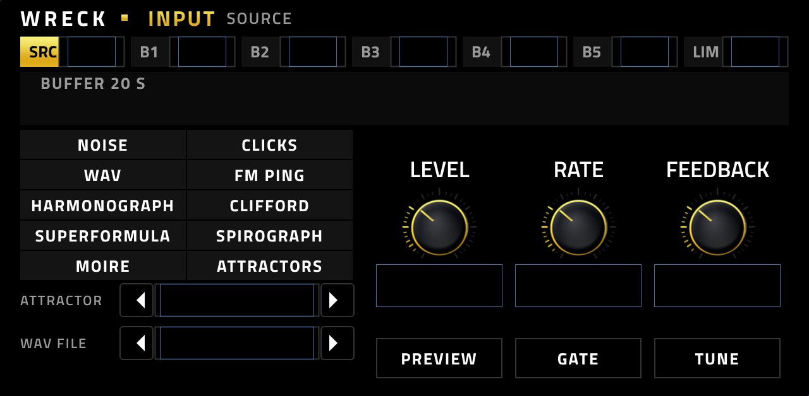

# Wreck

**A sound design instrument for the Akai Force and MPC OS (VST2, ARMv7).** Vendor: L'Cronx. Current version: 0.1.3.

Wreck is made for experimenting. It records its own sound into a 20 second loop, and your MIDI notes play that loop back as voices:
slower, faster, higher, lower, reversed, from fresh or older material. What the voices play can be fed back into the front of the
chain, so the instrument keeps reshaping itself. Start from noise, a click or a WAV file of your own, and you will keep finding
new sounds for hours.

## What it does

* **Ten sources** – noise, clicks, your own WAV files, FM pings, harmonograph, Clifford, superformula, spirograph, moire, and 15 chaotic attractors.
* **Five effect blocks in an order you choose** – drive, echo, filter, shift, smear – then a limiter.
* **A 20 second buffer that is always recording** the result.
* **Up to 16 voices** that read the buffer: speed, pitch, direction, attack, release, and four pitch modes (FREE, KEY, LOCK, PLAY).
* **An output bus** with a bouncing-ball delay, lo-fi and stutter, synced to the project tempo.
* **An arpeggiator with four polymetric lanes** (note, velocity, gate, octave) that plays the voices itself.
* **Four macros** (Chaos, Space, Grit, Body), **Monitor and Solo** on every stage, and a **direct** path.
* **22 factory presets and unlimited user presets.** A preset stores the WAV file by name.
* **A SAMPLES page** to load your own WAV files by tapping them in a list.

## The panel

The art is simple and readable for everyone: black, large white text, gold only where something is active. Wreck is a tool for
experimentation, so the screen stays out of the way and every stage of the chain has its own plain page.

## Install

Needs MPC OS 3.x on an armv7 Force/MPC. Download `Wreck-<version>-mpc-armv7.zip` from the Releases page, unzip it, and follow
`INSTALL.md` inside (or run `install.sh` on the device). Copy your own `.wav` files into
`/sdcard/Synths/L'Cronx - VST - Wreck/data/wav`, then open the SAMPLES page and tap RESCAN.

## Documentation

* [User guide](docs/USER_GUIDE.md): every page, the signal chain, Q-Links, presets, and musical approaches.
* [Changelog](CHANGELOG.md)

## Status

0.1.3 is built and passes the installer and catalog checks. It carries the same plugin file as 0.1.2 (byte for byte); only the license changed. 0.1.2 was verified working on an Akai Force (2026-11-07). The checklist and the
remaining open items are in `docs/CHECKLIST.md` and `docs/UNVERIFIED.md`.

## License

PolyForm Noncommercial 1.0.0, see [LICENSE](LICENSE). The source is public and free to use, change and share for any noncommercial purpose; selling Wreck or using it commercially is not permitted.

## Support

Free plugin. Tips: ko-fi.com/lcronx
